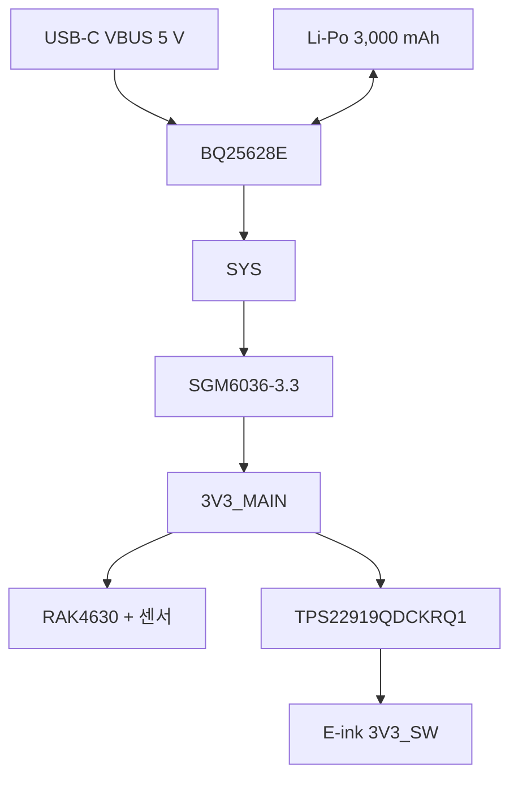

# 전원 시스템

## 전원 경로

## BQ25628E

BQ25628E는 단일 셀 리튬 이온·리튬 폴리머 배터리용 I²C 제어 충전기이자 파워패스 장치다. USB 전원이 있을 때 배터리를 충전하면서 SYS에 전력을 공급하고, USB가 없을 때는 배터리에서 SYS를 공급한다.

Ieum에서 기대하는 역할:

- USB 입력 전류 제한
- 배터리 충전 전류와 충전 전압 관리
- SYS 파워패스 제공
- 충전 및 오류 상태 확인
- ADC를 이용한 전원 상태 확인
- STAT 출력으로 노란색 충전 LED 제어
- Ship/Shutdown 계열 저전력 상태 활용

회로에 사용한 주요 값:

- ILIM: 3.3 kΩ
- TS 바이어스: 10 kΩ / TS-GND: 12 kΩ
- REGN: 4.7 µF
- PMID: 10 µF + 100 nF
- VBUS: 입력 디커플링 커패시터
- BTST: 47 nF

`INT`는 외부 pull-up을 사용하는 open-drain active-low 출력이며, TI 권장 pull-up은 10 kΩ이다. 상태 또는 fault 변경 시 기본 256 µs LOW 펄스를 출력한다. 호스트는 interrupt flag 레지스터를 읽어 원인을 확인하고, 읽은 flag는 clear된다. 전원 인가 펄스가 MCU 인터럽트 초기화보다 먼저 발생할 수 있으므로 드라이버는 시작할 때 flag와 status 레지스터를 직접 읽어 초기 상태도 확인해야 한다.

초기 펌웨어 정책은 다음과 같다.

- I²C 주소 `0x6A`와 part number field `4`를 확인한 뒤에만 레지스터를 변경한다.
- 입력 전류 제한은 500 mA로 두고, 3.3 kΩ ILIM 저항에 의한 약 0.76 A typical 하드웨어 제한도 계속 활성화한다.
- 충전 전류는 320 mA로 두고, 충전 전압은 배터리 보호를 위한 4.00 V를 Ieum 기본값으로 사용한다.
- 5 V USB-C 입력을 전제로 6.3 V 입력 과전압 보호를 선택한다.
- 첫 I²C 쓰기에서 `REG0x16[1:0]`을 `00b`로 설정해 호스트 watchdog을 비활성화하고, 칩의 safety timer, TS 감시, thermal regulation과 termination 기본 기능은 변경하지 않는다.
- InkHUD의 `Node Config → Power`에서 충전 상한을 4.00 V와 4.20 V 사이에서 전환하며, 성공한 선택은 `/prefs/bq25628e.dat`에 저장해 재부팅 후에도 적용한다.
- 저장 파일이 없거나 버전·checksum·값 검증에 실패하면 4.00 V로 복귀한다.
- ADC는 9-bit one-shot을 사용한다. USB 입력 중에는 모든 채널을 측정하고, 배터리 단독 구동 중에는 3.2 V 아래에서도 VBAT를 계속 측정할 수 있도록 TS ADC만 비활성화한다. 실기기에서 전체 채널 변환이 기존 60회 polling 제한을 넘는 것을 확인했으므로 실제 경과시간 기준 150 ms timeout을 적용하고, 완료되면 즉시 대기를 끝낸다.
- ADC 또는 초기 I²C 탐색이 실패하면 실제 0 V로 게시하지 않고 이전 정상값을 제한적으로 유지하며, BQ25628E 탐색을 주기적으로 재시도한다.
- `INT`가 누락되더라도 startup과 주기적 poll에서 read-to-clear flag, status와 fault를 읽는다. ADC 완료 인터럽트만 mask한다.
- 유효한 VBAT 측정값은 전용 배터리 레벨 어댑터를 통해 기존 Power 경로에 등록한다. 저전압 보호는 기존 `EVENT_LOW_BATTERY`와 수면 observer를 재사용한다. OCV 잔량 계산은 변경하지 않는다.
- Ieum의 검증용 초기 종료 조건은 USB 입력이 없고 유효한 새 VBAT 측정값이 **3.30 V 미만으로 3회 연속** 확인되는 것이다. 판정에 사용하는 저전압 측정은 최소 20초 간격으로 제한하므로 첫 저전압 판정부터 최소 40초가 필요하다. USB 연결, 배터리/USB 상태 불명, ADC 실패, 0 V 또는 임계값 이상 전압은 카운터를 초기화한다. 표시용 캐시값은 종료 판정에 재사용하지 않는다.
- 위 값은 `variant.h`의 `LOW_BATTERY_MV`, `LOW_BATTERY_READINGS`, `LOW_BATTERY_SAMPLE_INTERVAL_MS`에 모아 둔다. 실측으로 검증된 배터리 보호 기준이 아니며, 최종 부하·배터리·온도 조건에서 종료 여유와 순간 강하 내성을 확인해야 한다.
- 사용자 일반 종료에서는 Ship/Shutdown을 자동 실행하지 않는다. Ieum 저전압 종료에서만 `BQ25628E_SHUTDOWN_ON_LOW_BATTERY` 설정에 따라 지연 Shutdown을 요청한다. 명령 직전 status를 새로 읽어 VBUS 부재를 확인하며, 상태 읽기나 쓰기가 실패해도 MCU 종료를 계속한다.

노란색 충전 LED를 제어하는 `STAT`도 open-drain 출력이며 충전 중 LOW다. 이는 nRF52840이 직접 구동하는 active-high LED 2개와 구분한다. BQ25628E는 배터리 유무를 신뢰성 있게 판별하는 전용 bit가 없으므로 USB 입력 중에는 ADC의 VBAT 값만으로 배터리 장착 여부를 추정하지 않는다. USB 입력이 없고 유효한 VBAT가 측정되면 실행 중인 Ieum의 전원이 배터리에서 공급되는 것으로 판정한다.

320 mA와 사용자가 선택한 4.00 V/4.20 V 상한은 최종 배터리 사양 검증을 대신하지 않는다. 4.00 V 모드는 USB를 장시간 연결하는 개발 환경에서 배터리의 높은 충전 상태 체류 시간을 줄이기 위한 정책이다. 실기기 충전 전에는 셀의 최대 충전 전압·허용 전류, ILIM 실측값, TS 네트워크, USB source 전압과 충전 온도를 확인한다.

## 저전압 종료 순서와 검증 상태

1. 기존 PowerFSM의 저전압 이벤트에서 `doLowBatteryShutdown()`을 호출한다. 중복 요청은 무시한다.
2. 기존 preflight로 진행 중인 무선 작업의 완료를 기다린다. 저전압에서는 30초 timeout 후 재부팅하지 않고 종료를 계속한다.
3. 기존 deep-sleep observer로 GNSS 등 주변장치를 정리한다. InkHUD는 진행 중인 갱신을 기존 timeout 안에서 마치고 열린 패널 세션을 deep sleep·GPIO 격리·로드 스위치 차단 순서로 닫는다.
4. InkHUD의 사용자 applet 저장, 설정과 최근 메시지 저장, 기존 NodeDB 및 송신 이력 저장을 수행한다. 일반 Screen 빌드는 기존 메시지 저장소도 저장한다. 저전압에서는 InkHUD의 추가 종료 화면 갱신과 멜로디를 생략한다. 저장은 기존 저장 API와 전원 안전성 검사를 따르며, 호출만으로 저장 성공을 보증하지 않는다.
5. I²C가 살아 있는 `sleep.cpp`의 최종 단계에서 `enterShutdownMode(true)`를 요청한다. 기존 드라이버의 약 12.5초 지연 설정을 사용한다. `variant_shutdown()`은 `Wire.end()` 이후 호출되므로 PMIC 명령을 넣지 않는다.
6. 기존 `cpuDeepSleep(portMAX_DELAY)`로 진입한다. 역할 및 `sds_secs`에 따른 저전력 대기 후 리셋 분기를 피하고 System OFF를 사용한다. PMIC 명령 실패 시 SYS 차단은 보증하지 않으며 MCU 저전력 상태만 유지한다.

일반 종료와 일반 수면, 다른 보드의 OCV 기반 기본 임계값과 11회 판정은 유지한다. 공유 판정 코드는 조건 이탈 시 카운터 초기화, 0 V 배제, 포화 및 이벤트 중복 방지를 보완했다. nRF52 플랫폼 코드와 `variant_shutdown()`은 변경하지 않았다.

2026-11-01 코드 검증: `pio run -e ieum` 빌드 성공(RAM 92,876 B, Flash 662,992 B). `test/power/low_battery_counter.cpp`의 독립 C++17 호스트 회귀 테스트 3개 시나리오가 통과했다. Docker 기반 기존 네이티브 테스트는 Docker 데몬 미실행으로 실행하지 못했다. 운영자가 BLE OTA로 실기기 플래시 완료를 확인했다. 저전압 종료, BATFET/SYS 차단, USB 복구 및 설정 유지의 실기기 검증은 아직 보고되지 않았다.

실기기 원인은 아직 미확정이다. 가변 전원으로 다음을 검증한 뒤 하드웨어 검증 완료로 표시한다.

- 3.30 V 전후의 지속 저전압, 순간 강하 후 회복, ADC/I²C 실패, USB 연결 시 카운터 초기화
- PMIC 인터럽트가 연속 발생해도 판정 간 최소 20초 유지
- tracker/sensor 절전 설정에서도 종료 후 주기적 재부팅 없음
- 종료 중 E-ink BUSY timeout, GNSS UART 격리, 각 전원 레일의 역급전 및 off 전류
- Shutdown 성공/실패 로그, SYS 및 3V3_MAIN 차단, USB 재연결 부팅과 설정/메시지 유지
- 일반 종료·일반 수면 회귀 및 LoRa/BLE/USB/SWD 복구

## SGM6036-3.3

SGM6036-3.3은 SYS 전압을 노드의 메인 3.3 V 전원인 3V3_MAIN으로 변환한다. EN 핀은 기본 활성화되도록 풀업되어 있고, 슬라이드 스위치로 비활성화할 수 있다.

이 스위치는 배터리 도선을 직접 끊지 않는다. 따라서 3V3_MAIN이 꺼져도 BQ25628E와 배터리 충전 경로의 상태는 별도로 고려해야 한다.

## TPS22919QDCKRQ1

TPS22919-Q1은 자동차 등급의 저온저항 로드 스위치다. TPS22919DCKR 재고 문제로 Q1 제품인 TPS22919QDCKRQ1을 실장했다. Ieum에서는 E-ink 전원만 필요할 때 켜고 갱신이 끝나면 차단하는 데 사용한다.

펌웨어 요구사항:

1. 제어 GPIO를 안전한 비활성 상태로 초기화한다.
2. 로드 스위치를 켠 뒤 전원이 안정될 시간을 둔다.
3. E-ink 초기화와 화면 갱신을 수행한다.
4. bounded timeout 안에 BUSY가 해제된 것을 확인하고 패널을 deep sleep 상태로 보낸다.
5. SPI를 종료하고 SCLK, MOSI와 제어 핀을 high-Z로 만든다.
6. 로드 스위치를 끈다.

EN은 active high다. 전원 안정화 대기 시간은 실물 시험으로 확정한다. timeout이 발생하면 BUSY 중 추가 명령을 보내지 않고 SPI와 GPIO를 격리한 뒤 로드 스위치를 끈다.

## GNSS 전원

GNSS의 주 전원과 백업 전원을 구분한다. 주 전원은 위치 측정 시에만 공급하고, VBAT 백업 경로는 시간 및 위성 관련 정보를 유지해 다음 시작 시간을 줄이는 용도다. 액티브 안테나를 위한 VCC_RF 바이어스 경로에는 RF 초크와 디커플링이 있다.

## 전원 설계상 주의점

- BQ25628E의 SYS와 배터리 전압을 3V3_MAIN과 혼동하지 않는다.
- 전원이 꺼진 주변장치의 신호 핀으로 역급전하지 않도록 한다.
- 부팅 직후 E-ink와 GNSS가 의도치 않게 켜지지 않도록 GPIO 초기 상태를 먼저 정한다.
- Ship/Shutdown 동작은 EN 스위치에 의한 3V3_MAIN 차단과 별개의 기능으로 취급한다.
